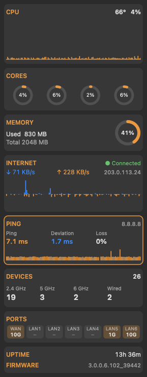
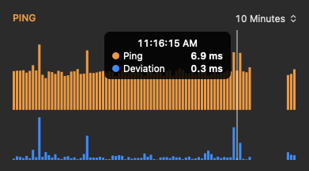
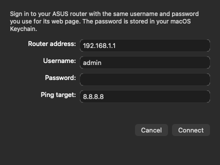

# RouterStats

Your ASUS router's CPU, memory, internet, ping and connected devices in the macOS menu bar, styled after iStat Menus.

The menu bar shows a CPU history graph and a RAM pie. Click it for the full panel; hover a section to see its history.

<p>
  
  
</p>

## What it shows

| Section | Details |
|---|---|
| **CPU** | Overall usage, router temperature, history graph |
| **Cores** | Usage ring for each core |
| **Memory** | Used / total RAM |
| **Internet** | Connected or offline, public IP, live download and upload speed |
| **Ping** | Ping, ping deviation (jitter) and packet loss, measured from your Mac |
| **Devices** | Count per band; hover for every device with its band, IP and signal strength |
| **Ports** | Link speed of each Ethernet port |
| **Uptime / Firmware** | Router uptime, firmware version, update notice |

Hovering CPU, Cores, Memory, Internet, Ping or Devices opens a side panel with up to 7 days of history. Pick the time range in its top-right corner, and hover the graph to see the time and values.

The menu bar icon turns red if the router stops answering or the internet goes down. Right-click it for **Open Network Map**, **Settings…** and **Quit**.

## Requirements

- An ASUS router with the standard ASUS web interface (ROG, ZenWiFi, RT-series and so on, including Asuswrt-Merlin)
- macOS 13 or later
- Xcode Command Line Tools for building (`xcode-select --install`)

## Install

```sh
git clone https://github.com/bj97301/RouterStats.git
cd RouterStats
./install.sh
```

This builds the app, installs it to `~/Applications/RouterStats.app` and sets it to start at login.

On first launch a setup window asks for:



- **Router address**: filled in with your Mac's default gateway. Use `https://192.168.1.1:8443` style if your router only allows HTTPS.
- **Username and password**: the ones you use for the router's web page.
- **Ping target**: the host to ping, `8.8.8.8` by default.

RouterStats tests the login before saving anything. The password is stored in your macOS Keychain, readable only by this Mac. The address, username and ping target are kept in the app's preferences. To change them later, right-click the menu bar icon and choose **Settings…**.

### Scripted setup

You can configure it without the window, with the password on standard input:

```sh
~/Applications/RouterStats.app/Contents/MacOS/RouterStats --configure 192.168.1.1 admin 8.8.8.8 < password.txt
```

## Uninstall

```sh
./uninstall.sh          # remove the app and login item
./uninstall.sh --all    # also delete settings, history and the saved password
```

## How it works

RouterStats uses the router's own web API, the same `login.cgi` and `appGet.cgi` endpoints the ASUS app uses. It signs in once, keeps the session token and asks for stats every 2 seconds. The device list, port speeds and firmware are refreshed every 30 seconds. Nothing is sent anywhere except your router.

Ping runs from your Mac (`/sbin/ping`), so it doesn't add load to the router. Ping deviation is the change from one ping to the next, the same way the ASUS Game Dashboard calculates it.

History is kept for 7 days in `~/Library/Application Support/RouterStats/history.json`: full 2-second detail for the last 24 hours, then one averaged point per minute (about 2 MB for a full week). It only covers the time your Mac was awake with RouterStats running.

## Troubleshooting

**The icon doesn't appear in the menu bar**
- Menu bar managers like Bartender or Ice hide new items by default. Set RouterStats to always show.
- Check **System Settings → Menu Bar → Allow in the Menu Bar** and make sure RouterStats is on.
- If you started the app from a terminal or another app, macOS may file its menu bar item under that app instead. Start it with `./install.sh` (it runs through launchd) or log out and back in.

**"The router rejected that username or password"**: check you can sign in to the router's web page with the same login. After several failed attempts ASUS routers block logins for a few minutes.

**macOS asks to allow Keychain access after rebuilding**: the app is signed locally, so a rebuilt copy counts as a new app. Choose **Always Allow**.

## License

MIT
